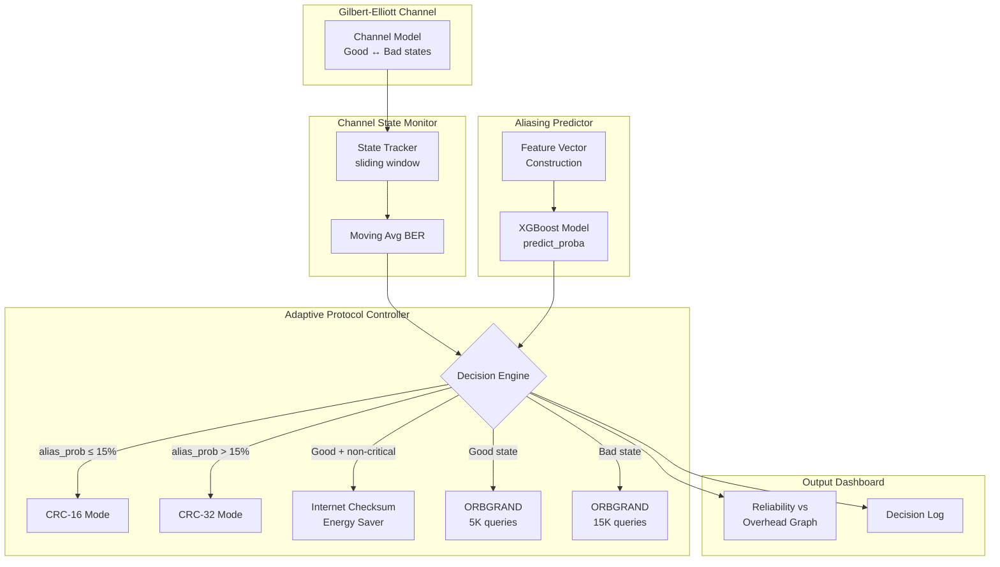

# Intelligent CRC Controller — Adaptive Error Control Protocol

## Overview

Build a Python module that acts as an **intelligent middleware** between the existing CRC engine, XGBoost model, channel, and ORBGRAND decoder. It monitors the Gilbert-Elliott channel in real-time, uses the trained XGBoost model to predict aliasing probability, and dynamically adjusts protocol parameters (CRC polynomial, ORBGRAND queries, or Internet Checksum fallback) to optimize the **Reliability vs. Overhead** trade-off.

## Three Pillars Emphasized

| Pillar | How the Controller Uses It |
|---|---|
| **Aliasing Engineering** (`E(x) = Q(x)·G(x)`) | XGBoost was trained on algebraically-constructed aliasing samples → the controller queries this model for aliasing probability predictions |
| **ORBGRAND Recovery** | Controller dynamically tunes `max_queries` (5K → 15K) based on channel state, treating CRC as stopping criterion |
| **High-Fidelity ML (99.8%+)** | Controller trusts XGBoost `predict_proba` to make real-time switching decisions |

---

## Proposed Changes

### Controller Module (NEW)

#### [NEW] [intelligent_controller.py](file:///c:/RISK_ASSESSMENT/CN%20MAJOR/controller/intelligent_controller.py)

The primary module. Contains 4 classes:

1. **`ChannelStateMonitor`** — Real-time Gilbert-Elliott channel tracker
   - Tracks per-frame channel state history (Good/Bad) using a sliding window
   - Computes moving-average BER, burst frequency, and state dwell times
   - Exposes `current_state`, `state_history`, `avg_ber`, `bad_state_ratio`
   - Uses the LLR reliability values from `ChannelModel` to infer state

2. **`AliasingPredictor`** — XGBoost-based aliasing probability estimator
   - Wraps the trained XGBoost model (loaded from `outputs/models/xgboost_model.joblib`)
   - Constructs feature vectors matching `FeatureEngineer.feature_columns` from current frame conditions
   - Returns `aliasing_probability` via `predict_proba`
   - Threshold: **15%** triggers CRC-16 → CRC-32 upgrade

3. **`AdaptiveProtocolController`** — Decision engine
   - **Proactive Switching Logic:**
     - `aliasing_prob > 0.15` → upgrade CRC-16 → CRC-32
     - Channel in Bad state → increase ORBGRAND `max_queries` from 5,000 → 15,000
   - **Energy-Efficiency Mode:**
     - Channel in Good state + non-critical header → use Internet Checksum instead of CRC
   - Maintains a **Decision Log** with timestamped entries
   - Computes **reliability score** and **overhead cost** per frame

4. **`ControllerDashboard`** — Live visualization
   - Real-time "Reliability vs. Overhead" graph (matplotlib animation or inline updates)
   - Decision Log display table
   - Channel state timeline
   - Current protocol configuration display

#### [NEW] [__init__.py](file:///c:/RISK_ASSESSMENT/CN%20MAJOR/controller/__init__.py)

Package init exposing the public API.

---

### Configuration Update

#### [MODIFY] [config.py](file:///c:/RISK_ASSESSMENT/CN%20MAJOR/config.py)

Add controller-specific settings:

```python
# ──────────────── Intelligent Controller ─────────────────────────
CONTROLLER_ALIASING_THRESHOLD = 0.15     # Aliasing probability threshold for CRC upgrade
CONTROLLER_ORBGRAND_NORMAL = 5_000       # ORBGRAND queries in Good state
CONTROLLER_ORBGRAND_AGGRESSIVE = 15_000  # ORBGRAND queries in Bad state
CONTROLLER_WINDOW_SIZE = 50              # Sliding window for channel state monitoring
CONTROLLER_ENERGY_SAVE = True            # Enable Internet Checksum for Good-state headers
```

---

### Colab Notebook Update

#### [MODIFY] [CRC_Complete_Colab_Notebook.py](file:///c:/RISK_ASSESSMENT/CN%20MAJOR/CRC_Complete_Colab_Notebook.py)

Add a new **Cell 15: Intelligent CRC Controller Demo** at the end of the notebook that:
- Imports and runs the controller on a simulated 500-frame Gilbert-Elliott transmission
- Shows all four components working together
- Produces the dashboard output inline

---

### Integration with Main Pipeline

#### [MODIFY] [main.py](file:///c:/RISK_ASSESSMENT/CN%20MAJOR/main.py)

Add a new **Phase 7: Intelligent Controller Demo** after the existing Phase 6, calling the controller simulation.

---

## Architecture Diagram



---

## User Review Required

> [!IMPORTANT]
> The controller module needs a **trained XGBoost model** saved at `outputs/models/xgboost_model.joblib`. If the main pipeline hasn't been run yet, the controller will train a quick model on the fly (using `generate_dataset` + `ModelTrainer`). This adds ~60s to first run.

> [!NOTE]
> The Colab notebook cell (Cell 15) is self-contained — it re-uses the `xgb_model` variable already trained in Cell 8, so no file I/O is needed when running in Colab.

---

## Open Questions

None — the existing codebase provides all the APIs needed. The `InternetChecksum` class is already in `evaluation/checksum_comparison.py` and the Colab notebook, so we'll import it for the energy-efficiency mode.

---

## Verification Plan

### Automated Tests
1. Run `python -c "from controller.intelligent_controller import AdaptiveProtocolController; print('Import OK')"` to verify module loads
2. Run the full controller simulation: `python -c "from controller.intelligent_controller import run_controller_demo; run_controller_demo()"`
3. Verify that decision log contains expected state transitions (CRC-16 → CRC-32, ORBGRAND 5K → 15K)

### Manual Verification
- Run the Colab notebook Cell 15 and visually confirm:
  - Reliability vs. Overhead graph renders correctly
  - Decision Log displays meaningful switching events
  - Channel state timeline shows Good/Bad transitions
